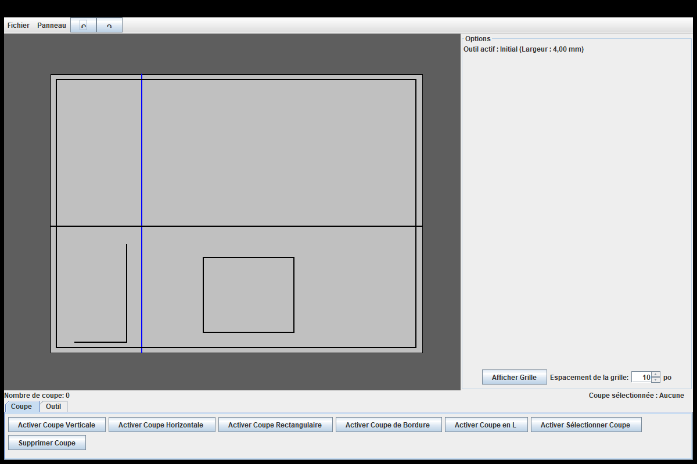

# CNC Panel Cutter

[](https://github.com/HAJID10/cnc-panel-cutter/actions/workflows/build.yml)

A Java 21 / Swing desktop app to plan the cuts on a wooden panel for a CNC router, and export them as G-code.
You set the panel size, place cuts with the mouse or with exact values, pick a tool (router bit) for each cut,
mark the areas the bit must never touch, and the app writes the program for the machine.



## Features

- **Five kinds of cut**: vertical, horizontal, rectangular, L-shaped (any direction) and border (trims the panel
  to a final size, always centred, exactly the size you type).
- **Mouse or exact values**: click on the panel, or type positions in the side panel. Any cut can be selected,
  dragged, or edited by values.
- **Depth per cut**: through cuts (the default) or grooves; shallow grooves are drawn lighter.
- **Tools**: several bits with their own width. Changing a width updates every cut that uses it, and a tool still
  in use can't be deleted.
- **Forbidden zones** (clamps, screws): a cut that would touch one is refused. A zone placed over existing cuts
  shows them in red, and G-code export waits until they are fixed.
- **Checks**: cuts must stay on the panel; duplicates and rectangles smaller than the bit are refused, with a
  clear message.
- **Millimetres or inches** (View menu). The model and the files always stay in millimetres.
- **Undo / redo** (last 100 steps), **projects saved as readable JSON**, **G-code export**, grid with snapping,
  zoom and pan.

## Using it

| Action | How |
|---|---|
| Add a cut | Pick its type in the *Cuts* tab, then click on the panel (two clicks for a rectangle, an L or a zone), or fill in the side panel and press *Add*. |
| Edit a cut | *Select / move*, click the cut, change the values, *Apply*. Or drag it. |
| Delete | Select it, then *Delete selected* or the Delete key. |
| Zoom / pan | Mouse wheel / drag an empty spot. *Fit panel to window* resets the view. |
| Tools | *Tools* tab: add a bit, change its width, choose the one used for new cuts. |
| Files | *File*: new panel, open / save (`.json`), export G-code (`.nc`). Ctrl+Z / Ctrl+Y undo and redo. |

### A short walkthrough

This example uses every feature once. It cuts a 4 × 3 ft sheet into parts for a small cabinet.

1. **New panel.** In *File › New panel…*, enter length 914.4, width 1219.2, thickness 18 (mm).
2. **Tools.** Open the *Tools* tab and add a bit named `1/4 in bit`, 6 mm wide. Select it and use
   *Change width…* to set it to the real 6.35 mm. The 4 mm *Default bit* is still used for new cuts.
3. **Border.** Click *Border*, then type a final width of 1200 and a final length of 900, and press *Add*.
   The sheet is trimmed all around and stays centred.
4. **Straight cuts.**
   - Click *Vertical*, measure from *Left edge* with a distance of 600, then *Add*.
   - Add a second one measured from *Existing cut* (x = 600), *Right of it*, at 300. It lands at x = 900.
   - Click *Horizontal*, measure from *Top edge* with a distance of 450, then *Add*.
5. **A groove for a shelf.** Still in *Horizontal*, use a distance of 225, choose the `1/4 in bit`, set the
   depth to 6, then *Add*. It is drawn lighter because it doesn't go through the panel.
6. **A hand hole.** Click *Rectangle*, then click two opposite corners in the bottom-left part of the panel.
   Switch to *Select / move*, click the rectangle and type exact values: left 150, top 600, width 300,
   height 150. Press *Apply*.
7. **A decorative L.** Click *L-shape* and type start (950, 500), corner (1150, 850) and depth 9.
   Press *Add*.
8. **A clamp.** Click *Forbidden zone* and add left 280, top 400, width 100, height 100.
   - The horizontal cut at 450 runs under it, so it turns red and a message explains why.
   - Try a *Vertical* cut at 330: it is refused.
   - Try *File › Export G-code…*: it is refused too, because one cut still touches the clamp.
9. **Fix it.** In *Select / move*, click the zone, change its top to 470 and press *Apply*. The red cut turns
   back to normal.
10. **Tool rules.** In the *Tools* tab, try to remove the `1/4 in bit`: it is refused, because the groove uses it.
11. **Move, snap, undo.**
    - In the side panel, tick *Show grid* and set the spacing to 50. Drag the rectangle: it snaps to the grid.
    - Ctrl+Z puts it back, and Ctrl+Y moves it again.
    - Select the L, press Delete, then Ctrl+Z to bring it back.
    - Escape cancels a rectangle or an L after its first click.
12. **Inches.** In *View › Inches*, every value switches to inches (the panel is 48 × 36 in). Switch back
    with *View › Millimetres*.
13. **View.** Zoom with the mouse wheel and pan by dragging an empty spot. *Fit panel to window* brings it
    all back.
14. **Files.**
    - *File › Save…* as `cabinet.json`. Create a *New panel*, then *File › Open…* `cabinet.json`: everything
      comes back, including the clamp.
    - *File › Export G-code…* as `cabinet.nc`. The program cuts with the 4 mm bit first, then stops (`M0`) so
      you can load the `1/4 in bit` for the groove.

### G-code conventions

- Millimetres, absolute coordinates (`G21 G90`).
- Origin at the **bottom-left corner** of the panel, **Z0 on the top surface**. The screen shows y going down,
  so machine Y = panel length − y.
- One pass per cut at its full depth. Cuts are grouped by tool, with an `M0` stop to change the bit.
- Fixed defaults: feed 1000 mm/min, plunge 300 mm/min, safe height 5 mm, spindle 18 000 rpm.
  **Check them for your machine and material before running the program.**

## Build and run

Requirements: JDK 21. Maven is not needed, the wrapper downloads it.

```bash
./mvnw package                      # compiles and runs the 86 tests (mvnw.cmd on Windows)
java -jar target/cnc-panel-cutter.jar
```

## Architecture

```
gui (Swing)  ──>  controller.CncController  ──>  domain: Panel, Cut + 5 subclasses, Tool, ForbiddenZone
                         │
                         ├── dto + mappers   read-only copies for the screen, the undo history and files
                         └── infra           History (undo/redo), ProjectFile + Json, GCodeWriter
```

- The interface only receives DTOs, so it can't change the model behind the controller's back.
- Each cut describes the **path** followed by the centre of the bit (`Line2D`, `Path2D`, `Rectangle2D`). The
  removed material, the click area, the drawing, the zone checks and the G-code are all derived from that path,
  so they always agree.
- Every change goes through one method of the controller: if the domain refuses it, the panel is put back as it
  was and no empty undo step is left.
- No dependencies apart from JUnit 5 (JSON reading and writing is a small class of its own).

The original UML model (Visual Paradigm) is in [`docs/modele-uml.vpp`](docs/modele-uml.vpp).

## Changelog

**2026, after the course**

- Code, interface and documentation translated to English; the cut types now carry their own behaviour (no more
  chains of `instanceof`).
- New: depth per cut, forbidden zones, L-cut editor, mm / inch switch, G-code export, decimal positions.
- Projects saved as JSON instead of Java serialization (files survive code changes, and opening one can't run
  code).
- Fixed: empty undo steps after a refused action, deleting a tool still in use, negative sizes for L cuts drawn
  backwards, duplicate cuts, borders 4 mm too small, depth equal to the bit width, rounding to whole millimetres.
- Maven wrapper, GitHub Actions build, 86 tests (there were 30).

**Earlier fixes**: tests that no longer compiled, moving a cut through the interface that moved a copy, cut ids
that changed after undo or loading, redo that broke the history, border and half of the L that couldn't be
selected, cut areas twice too wide, rectangles stretched when moved, `.jar` that wouldn't start.

## Credits

Projet d'équipe réalisé dans le cadre du cours GLO-2004 / IFT-2007 (Génie logiciel orienté objet, Université
Laval, automne 2024) par **Ismail Regragui, Taha-Yassine Rouissi, Bilal Draa, Yassine Tabet et Hajid Jeddi**.
Reprise et améliorations en 2026 par Hajid Jeddi.

MIT License, see [`LICENSE`](LICENSE).
