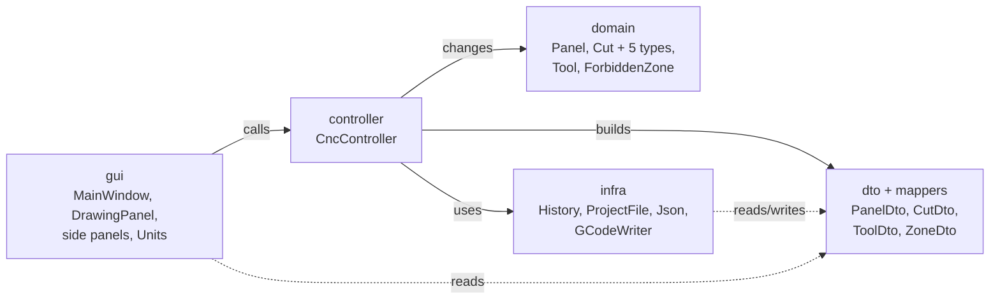
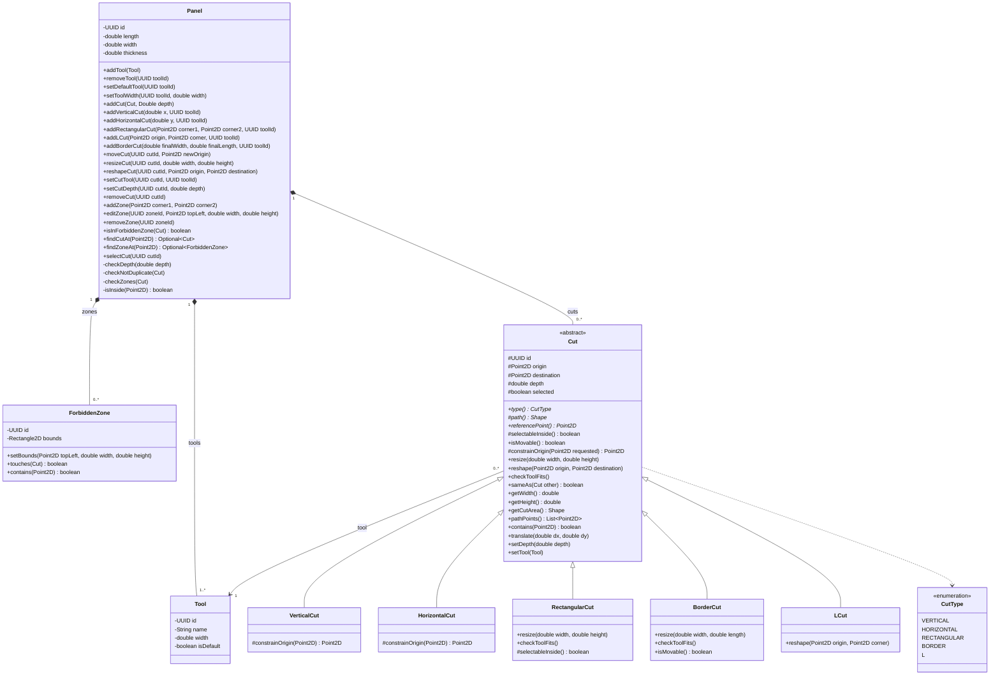
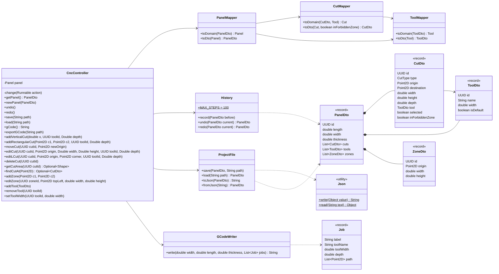
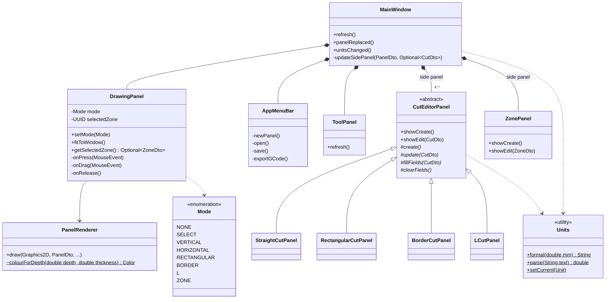
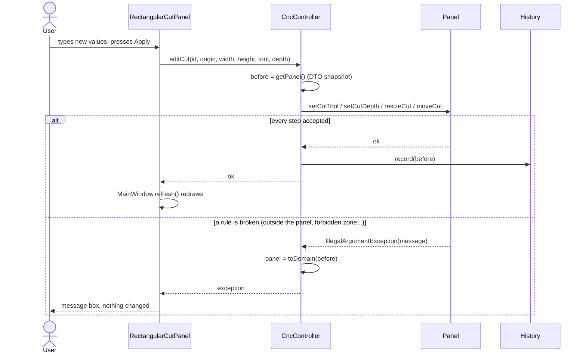

# UML model

Class and sequence diagrams of the current code, written in [Mermaid](https://mermaid.js.org/) so GitHub draws
them on this page and they can be updated with the code. Only the main members are shown. Overloads that add an
optional `depth` and simple getters/setters are left out.

The original course model (Visual Paradigm, autumn 2024) is still in [`modele-uml.vpp`](modele-uml.vpp). It
shows the French design from before the 2026 rewrite.

## 1. Layers

The interface only talks to the controller and only receives DTOs (read-only copies). The domain knows nothing
about Swing, files or G-code.

## 2. Domain

Each cut describes the **path** followed by the centre of the bit. The removed material (`getCutArea`), the click
area, the drawing, the forbidden-zone check and the G-code (`pathPoints`) are all derived from that one path.
Each subclass decides how it moves, resizes and checks itself, so `Panel` never tests the concrete type.

Rules enforced by the domain (every refusal is an `IllegalArgumentException` with a message for the user):

| Rule | Where |
|---|---|
| A cut stays on the panel | `Panel.isInside` on add, move, resize, reshape |
| No exact duplicate | `Cut.sameAs`, `Panel.checkNotDuplicate` |
| A rectangle or border is not smaller than its bit | `checkToolFits` in `RectangularCut` and `BorderCut` |
| An L has two arms | `LCut` constructor and `reshape` |
| 0 < depth ≤ panel thickness | `Panel.checkDepth` |
| No new or moved cut touches a forbidden zone | `ForbiddenZone.touches`, `Panel.checkZones` |
| A tool used by cuts can't be removed; there is always a default tool | `Panel.removeTool` |
| A vertical cut only slides sideways, a horizontal one up and down, a border never moves | `constrainOrigin`, `isMovable` |

## 3. Controller, DTOs and infrastructure

## 4. User interface

`StraightCutPanel` serves both vertical and horizontal cuts. All of these classes call `CncController`, which is
left out of this diagram to keep it readable.

## 5. A change, step by step

Every change goes through `CncController.change`. The state before the change goes into the undo history only if
the domain accepts the change. If it is refused, the panel is rebuilt as it was, so a refused action leaves no
trace and a multi-part edit is all-or-nothing.

